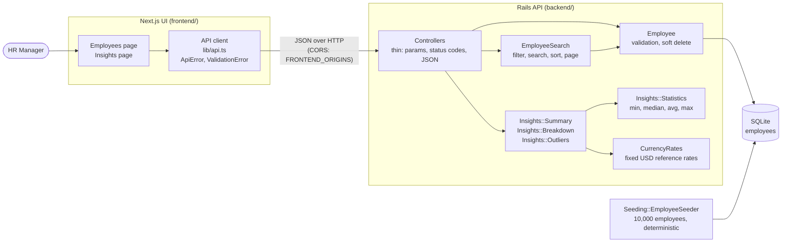
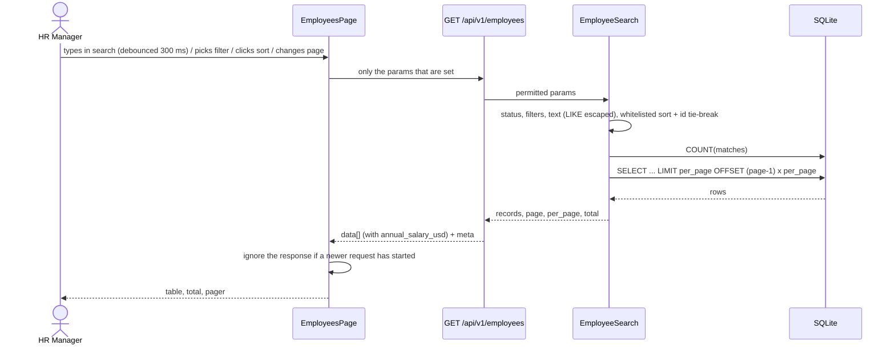
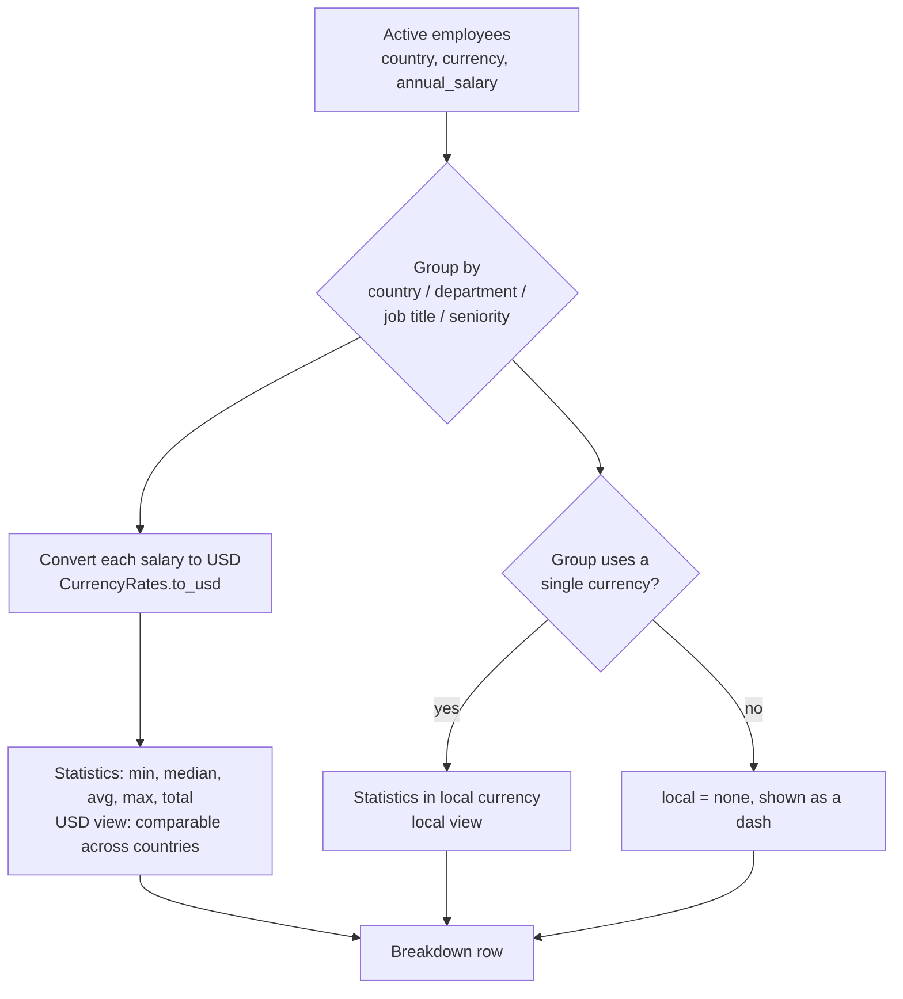
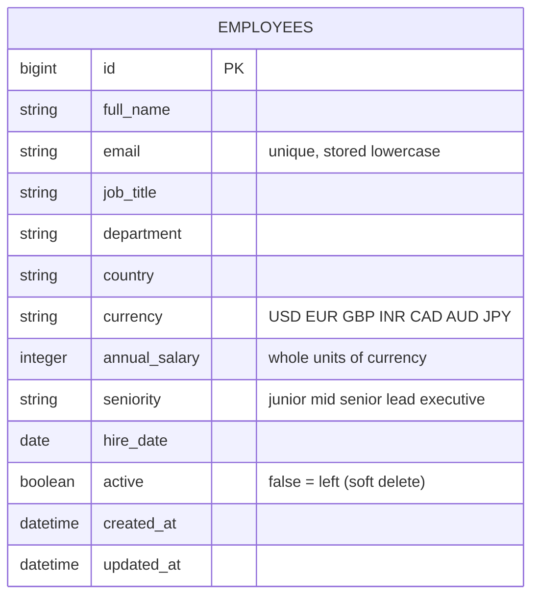

# Architecture diagrams

GitHub renders these diagrams directly. Reasoning and trade-offs are in [DESIGN.md](DESIGN.md).

## 1. System overview

## 2. Listing employees

## 3. How insights compare pay across currencies

Outliers use the same USD values: each active person is compared with the median of peers who share
country, job title and seniority; below 0.7x or above 1.4x is flagged; groups smaller than 5 are skipped.

## 4. Data model

Indexes: unique `email`; `(active, country)`, `(active, department)`, `(active, seniority)`,
`(active, country, job_title)`; `full_name`.
